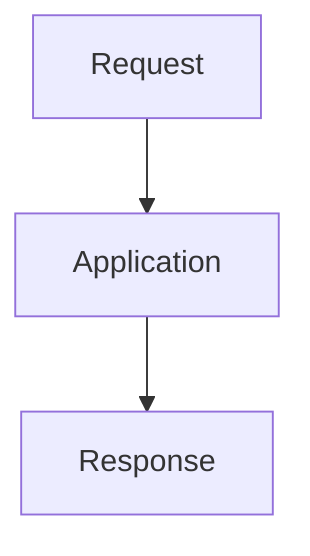

# Implement: Add search

_Repo: `` · branch `main`_

**Run status:** `approved` · **Mode:** `blocking`
**Run ID:** `14cb24d4d9914951a49f45ffb875402b`

## 0. Refinement

Implement and verify: Add search

### Assumptions
- Deterministic mock mode; replace with real LLM output for semantic refinement.

## 1. Output Contracts & Definition of Done

| ID | Kind | Name | Schema | Requirements | Status codes |
|---|---|---|---|---|---|
| CON-001 | json | feature-response | FeatureResponse{v1} | REQ-001 | 200, 400 |

### DoD
- [✓] `DOD-001` The requested behavior is verifiable: Add search
- [✓] `DOD-002` No hardcoded secrets; all secrets via environment variables
- [✓] `DOD-003` All user inputs validated with schemas before processing
- [✓] `DOD-004` Parameterized queries only; no SQL string concatenation
- [✓] `DOD-005` User-provided HTML sanitized; no unvalidated dynamic rendering
- [✓] `DOD-006` AuthN/AuthZ checks before sensitive operations
- [✓] `DOD-007` Generic error messages to users; details server-side only

### Milestones
1. `MILE-001` **scaffold** — Tests and contract skeleton are in place. _(requirements: REQ-001)_
2. `MILE-002` **implement** — Definition of Done is verified. _(requirements: REQ-001)_

## 2. PRD

_Deterministic mock specification generated without external model calls._

### Requirements
- `REQ-001` [P1] Add search

### Non-goals
- Unrequested production deployment

### Acceptance criteria
- `ACC-001` The implementation satisfies the requested behavior: Add search _(requirements: REQ-001)_

**Users:** development team

## 2b. TRD

### Components
- application layer
- persistence/integration boundary
- test suite

### Flow

## 2c. Security Assessment

| ID | Check | Status | Notes |
|---|---|---|---|
| SEC-001 | A01 broken-access-control | pass | Enforce AuthN/AuthZ before sensitive operations |
| SEC-002 | A02 cryptographic-failures | pass | Secrets via env vars only; no hardcoded credentials |
| SEC-003 | A03 injection | pass | Validate all inputs with schemas; parameterized queries only |
| SEC-004 | A04 insecure-design | pass | DoD acceptance criteria verifiable; secure defaults |
| SEC-005 | A07 XSS | pass | Sanitize user-provided HTML; no unvalidated dynamic rendering |

**Input sanitization:** Validate all user input with schemas at boundaries.

**Auth enforcement:** Require AuthN/AuthZ checks before sensitive operations.

- OWASP Top-10 reviewed; see security.owasp_checks
- Input sanitization enforced at system boundaries
- Auth enforcement verified before sensitive operations

## 3. TDD Suite & Roadmap

| ID | Test | Kind | File | Requirements | Contracts | Priority |
|---|---|---|---|---|---|---|
| TEST-001 | integration: contract feature-response responds per schema | integration | `tests/test_feature-response.py` | REQ-001 | CON-001 | P0 |
| TEST-002 | unit: milestone 'scaffold' acceptance | unit | `tests/test_scaffold.py` | REQ-001 |  | P1 |
| TEST-003 | unit: milestone 'implement' acceptance | unit | `tests/test_implement.py` | REQ-001 |  | P1 |

1. `STEP-001` **Implement: scaffold**
   Tests and contract skeleton are in place.
   Tests: `unit: milestone 'scaffold' acceptance`
   Test IDs: TEST-002
2. `STEP-002` **Implement: implement**
   Definition of Done is verified.
   Tests: `unit: milestone 'implement' acceptance`
   Test IDs: TEST-003

_RED/GREEN: RED: write each test first and watch it fail. GREEN: implement the minimal code to pass. REFACTOR: clean up while keeping the suite green._

**Coverage target:** ≥80%

## Critic Gate

Approved: **True**
